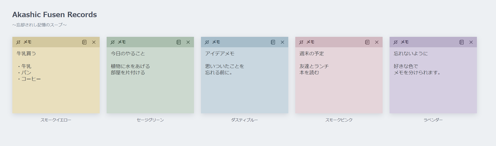

# Akashic Fusen Records

## ～忘却されし記憶のスープ～

**「牛乳買う」を、宇宙規模で記録する。**

思いついたアイデア。あとでやること。買い物のメモ。推しグッズの予約開始日。彼女の誕生日。おまけで、取引先との会議の予定も。

「覚えておこう」と思ったことほど、気づけば忘却の彼方へ。

大丈夫。もう脳のリソースをそこに割く必要はありません。

その記憶、デスクトップにそっと貼っておきませんか？

**Akashic Fusen Records** は、Windowsのデスクトップに置いて使う、シンプルな付箋アプリです。

くすんだ5色の付箋に、忘れたくないことを書き留められます。
付箋の内容・位置・大きさ・色は自動保存。次に起動したときも、前回の状態から使えます。

壮大な名前と宇宙のアイコンで、今日の小さな用事を記録します。

## できること

| 機能 | できること |
| --- | --- |
| 付箋を追加 | デスクトップに最大5枚のメモを置けます。 |
| 色を選ぶ | 黄・緑・青・ピンク・紫の5色から、付箋ごとに好きな色を選べます。作成後にも変更できます。 |
| 移動・サイズ変更 | 好きな場所に置き、書く量に合わせて大きさを変えられます。 |
| 自動保存 | 本文・位置・大きさ・色を保存し、次回の起動時に復元します。 |
| テキスト保存 | メモの本文を `.txt` ファイルとして保存できます。付箋自体も残ります。 |
| 通知領域に常駐 | アプリの操作は、タスクバー端の小さなアイコンから行います。付箋ごとのボタンがタスクバーに並ぶことはありません。 |

アプリの利用に、インターネット接続やアカウント登録は必要ありません。メモはこのPC内に保存します。

## ダウンロード

**Windows 64ビット用・インストール不要。**

ReleasesのAssetsから、`AkashicFusenRecords-1.0.0-Windows.exe` をダウンロードしてください。

[最新版をダウンロード](https://github.com/Geek0426/AkashicFusenRecords/releases/latest)

ダウンロードした実行ファイルを、普段使うフォルダに置いてダブルクリックすると起動します。

この版にはデジタル署名がありません。Windowsが警告を表示する場合があります。ダウンロード元を確認してから実行してください。

## はじめての使い方

### 1. アプリのアイコンを探す

起動すると、Windowsの**通知領域**に、宇宙と黄色い付箋のアイコンが現れます。

通知領域は、タスクバーの時計や音量アイコンがある辺りです。
アイコンが見えないときは、その近くの **「∧」** を押して、隠れているアイコンの一覧を開いてください。

初回は、ここから最初の付箋を作ります。

### 2. 付箋を作る

アプリのアイコンを**右クリック**し、**「新しい付箋を追加」**を選びます。

付箋が開くと、5つの色の丸が表示されます。好きな色をクリックしてから、本文を書いてください。

付箋は最大5枚まで追加できます。

### 3. 場所と大きさを変える

- **場所を変える**：付箋の上のバーをドラッグします。
- **大きさを変える**：付箋の端や角をドラッグします。

本文や配置は自動で保存されるので、普段のメモ書きに保存ボタンを押す必要はありません。

## 付箋の上にあるボタン

### 左の画鋲マーク：色を変える

画鋲マークを押すと、5つの色の丸が表示されます。

好きな色を選ぶと、その付箋の色が変わります。メモの内容と大きさはそのままです。

買い物・予定・アイデアなど、用途ごとに色を分けて使えます。

### 右のメモ帳マーク：テキストで保存する

メモ帳マークを押すと、保存場所とファイル名を選ぶ画面が開きます。

1. 保存したいフォルダを選びます。
2. ファイル名を付けます。
3. 「保存」を押します。

本文が **`.txt` ファイル**として保存されます。保存したファイルは、Windowsのメモ帳などで開けます。

テキスト保存をしても、デスクトップの付箋はそのまま残ります。
キーボードの **`Ctrl+S`** でも同じ操作ができます。

### 右端の「×」：付箋を削除する

「×」を押すと、削除するか確認する画面が開きます。

「削除する」を選ぶと、その付箋が削除されます。
残したい場合は「キャンセル」を選んでください。

**「×」は、付箋を削除するボタンです。メモを残してアプリを終了するときは、次の方法を使ってください。**

## アプリを終了する・メモを再表示する

通知領域のアプリのアイコンを右クリックすると、次のメニューが開きます。

- **新しい付箋を追加**：新しいメモを作ります。
- **すべての付箋を表示**：ほかのウィンドウの後ろにある付箋も、まとめて表示します。
- **終了**：メモを保存して、アプリを終了します。

「終了」を選んでも、付箋は削除されません。次にアプリを起動すると、保存されたメモが戻ります。

## PC起動時に自動で開くには

毎回アプリを起動する手間を省きたい場合は、Windowsのスタートアップフォルダに、アプリのショートカットを登録できます。[Microsoftの説明](https://support.microsoft.com/ja-jp/windows/experience/startup-boot/configure-startup-applications-in-windows)

1. キーボードの **Windowsキー＋R** を押します。
2. `shell:startup` と入力し、Enterを押します。
3. 開いたフォルダの何もないところを右クリックし、**「新規作成」→「ショートカット」**を選びます。
4. 「参照」から、普段使う場所に置いたアプリの実行ファイルを選び、「次へ」「完了」と進みます。

次回から、Windowsにサインインするとアプリが自動で起動し、前回の付箋を表示します。

自動起動を設定したあとは、実行ファイルを同じ場所で使ってください。

## 付箋の保存と、テキスト保存の違い

- **自動保存**：次にアプリを開いたとき、同じメモ・位置・大きさ・色で再開するための保存です。
- **テキスト保存**：本文を、メモ帳などでも読める別のファイルとして残すための保存です。

普段はそのまま書くだけで大丈夫です。ファイルとして残したいメモは、メモ帳マークから保存してください。

---

**忘却される前に、一枚貼っておこう。**

宇宙の記録庫にも、今日の「牛乳買う」があっていい。

---

# English

## Akashic Fusen Records — Soup of Forgotten Memories

**Record “Buy milk” on a cosmic scale.**

A sudden idea. Something to do later. A shopping list. The opening date for your favorite fandom merch preorders. Your girlfriend’s birthday. And, as a bonus, that meeting with a client.

The things you tell yourself to remember are often the first to vanish into oblivion.

It’s all right. You no longer need to spend your brain’s resources on remembering them.

Why not gently stick those memories onto your desktop?

**Akashic Fusen Records** is a simple sticky note app for the Windows desktop.

Write down what you want to remember on notes in five muted colors. Your text, note positions, sizes, and colors are saved automatically and restored the next time you launch the app.

A grand name and a cosmic icon, keeping track of today’s little tasks.

## Features

| Feature | What it does |
| --- | --- |
| Up to five notes | Keep as many as five sticky notes on your desktop. |
| Five muted colors | Choose yellow, green, blue, pink, or purple for each note. You can change the color later. |
| Move and resize | Drag a note to your preferred position and adjust its size to fit your writing. |
| Automatic saving | Save and restore text, positions, sizes, and colors. |
| Text export | Save a note’s text as a `.txt` file while keeping the sticky note on your desktop. |
| Notification area | Manage the app from its notification area icon. Individual notes do not add buttons to your taskbar. |

No account or internet connection is required to use the app. Notes are saved on your PC.

## Download

[Download the latest release](https://github.com/Geek0426/AkashicFusenRecords/releases/latest)

**64-bit Windows. No installation required.**

Download **`AkashicFusenRecords-1.0.0-Windows.exe`** from the release’s **Assets**, place it in a folder you normally use, and double-click it to launch.

This build is not digitally signed. Windows may display a warning; verify the download source before running it.

The interface uses Japanese labels. The controls are explained below with their English meanings.

## Getting started

### 1. Find the app’s icon

After launch, look for the cosmic yellow sticky note icon in the Windows notification area, near the clock and volume icons.

If it is hidden, select **∧** to expand the list of icons.

On the first launch, create your first note from this icon.

### 2. Create a note

Right-click the icon and select **新しい付箋を追加** (Add a new note).

Five colored circles appear on the new note. Select your preferred color and start writing.

You can have up to five notes.

### 3. Move or resize it

- **Move:** Drag the bar at the top of the note.
- **Resize:** Drag an edge or corner of the note.

Text and layout are saved automatically. You do not need to press a Save button during ordinary note-taking.

## Note buttons

### Left pin icon: Change the color

Select the pin icon to show the five colored circles.

Choose a color to change that note. Its text and size stay the same.

Use different colors for shopping, plans, ideas, or anything else you want to separate.

### Right notebook icon: Export the text

Select the notebook icon to open the Save dialog.

1. Choose a folder.
2. Enter a filename.
3. Select Save.

The text is saved as a **`.txt` file**, which you can open in Windows Notepad or another text editor.

Exporting does not remove the sticky note. **Ctrl+S** performs the same action.

### Rightmost ×: Delete the note

Select × to open a confirmation dialog.

- **削除する** (Delete): Delete this note.
- **キャンセル** (Cancel): Keep it.

**× deletes a note. To quit the app while keeping your notes, use the notification area menu described below.**

## Quit or show your notes again

Right-click the app’s notification area icon to open its menu.

- **新しい付箋を追加** (Add a new note): Create another note.
- **すべての付箋を表示** (Show all notes): Bring your notes into view.
- **終了** (Quit): Save your notes and quit the app.

Quitting does not delete your notes. They are restored when you launch the app again.

## Start automatically with Windows

To launch the app automatically, place a shortcut to its executable in your Windows Startup folder. [Microsoft’s instructions](https://support.microsoft.com/en-us/windows/experience/startup-boot/configure-startup-applications-in-windows)

1. Press **Windows+R**.
2. Enter `shell:startup` and press Enter.
3. Right-click an empty space in the folder and select **New → Shortcut**.
4. Use **Browse** to select the app’s executable from the folder where you keep it, then select **Next** and **Finish**.

The app will launch and restore your notes the next time you sign in to Windows.

After setting up automatic startup, keep the executable in the same location.

## Automatic saving and text export

- **Automatic saving** lets you resume with the same text, note positions, sizes, and colors.
- **Text export** saves the contents as a separate file you can read in other apps.

For everyday use, simply write on your notes. Use the notebook icon when you want to keep a memo as a separate file.

---

**Stick it somewhere before it slips into oblivion.**

There’s room for today’s “Buy milk” in the cosmic archive, too.

